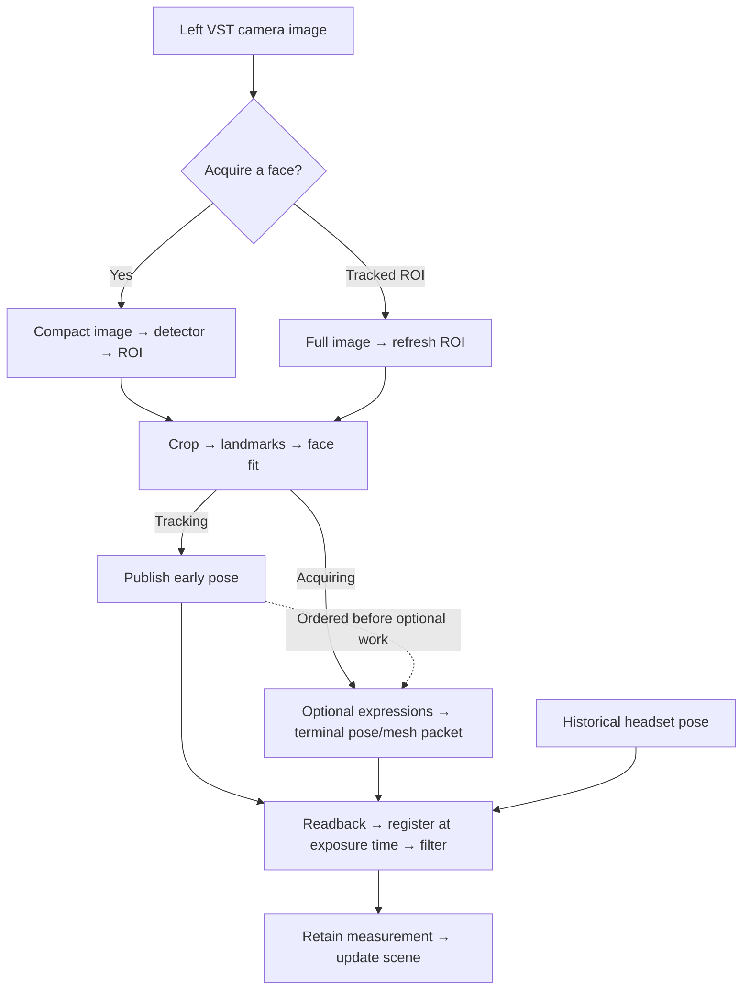
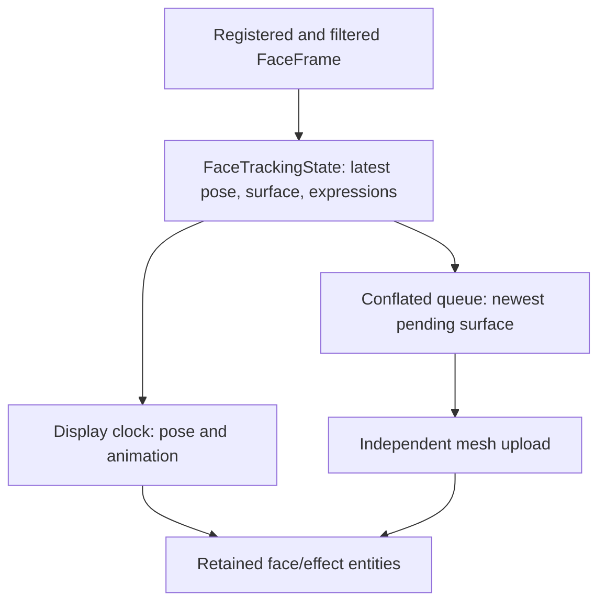

# Face Landmarker sample

A Kotlin sample that tracks **one face seen by a PICO headset’s outward camera** and draws a
mesh or selected effect over that person in a Mixed Full Space Stage. It estimates 478 landmarks,
a face pose, and optionally 52 expression coefficients. Camera images remain in the SpatialML
service; the app reads numerical results and renders the effects over passthrough.

| Face mesh | Closed helmet |
| --- | --- |
|  |  |

## Build and run

Follow the repository’s [environment setup](../README.md#requirements). Use JDK 21, Android SDK 35,
and a PICO OS 6 headset with SpatialML/LiteRT support. This checkout uses Spatial SDK **6.2.8**,
Gradle 8.13, AGP 8.9.1 and Kotlin 2.0.21; the app targets Android 35, requires API 31 or later and
builds for `arm64-v8a`. The emulator cannot validate camera inference or face alignment.

From the repository root:

```sh
git lfs pull
./gradlew :FaceLandmarkerApp:assembleDebug
```

Select `FaceLandmarkerApp` in Android Studio and run it on the headset, or install and launch the
APK with the intended device serial:

```sh
adb -s HEADSET_SERIAL install -r FaceLandmarkerApp/build/outputs/apk/debug/FaceLandmarkerApp-debug.apk
adb -s HEADSET_SERIAL shell am start -n com.pico.spatial.ml.sample.facelandmarker/com.pico.spatial.ml.sample.facelandmarker.platform.MainActivity
```

Grant camera access and look toward another person. Start with **Face mesh** to inspect alignment
in both eyes. Models and artwork are included; no API key, asset-generation step or build flags
are needed. The sample’s release variant uses debug signing; configure distribution signing
before publishing an APK.

## Controls and effects

The Stage owns tracking; the movable control window observes it. Drag the system caption bar to
move the window. Dismissing it leaves tracking active, and **Options** reopens it. **Pause** hides
the effect and stops new inference submissions while retaining the session; **Resume** resumes
tracking. **Close** or platform Back ends the Stage and releases its resources.

| Effect | Behavior |
| --- | --- |
| **Face mesh** | Default cyan wireframe follows the measured face surface. |
| **Opening helmet** | A retained helmet follows the face; its visor alternates between ten-second closed/open phases. |
| **Closed helmet** | A fitted solid helmet follows the face without visor animation. |
| **Buggy eyes + grin** | Eye/mouth landmarks position the geometry; blink, gaze and mouth expressions animate it. |
| **Red pigtails** | Procedural braids follow a crown position estimated from the measured face. |
| **USA cheek flags** | Generated cheek paint follows the deforming face mesh. |
| **Team colors** | Blue/gold paint uses the same measured surface. |
| **Lion dance** | Mouth opening, independent blinks and gaze drive the lion’s jaw, eyelids and eyes. |

Selecting an effect changes the visible renderer and requested outputs. Buggy eyes and lion dance
request expressions; other effects need pose and mesh. Output selection is captured per submission,
so changing the output mask suppresses incompatible in-flight results. All effect assets are
loaded at startup.

## Application structure

| Component | Responsibility |
| --- | --- |
| **FaceLandmarkerApp** | Stage, controls, tracking lifecycle, scene and effects. |
| **[face-landmarker](../face-landmarker/README.md)** | Kotlin graph, 13 runtime models, result decoding, calibration, filtering, retention and mesh helpers. |
| **[perception](../perception/README.md)** | Native graph ownership, Stage pose history and coordinate transforms. |
| **buildSrc** | Shared Android/Spatial SDK build conventions. `common` is used by other samples and is not a dependency of this target. |

The [manifest](src/main/AndroidManifest.xml) requests camera permission and declares the Full Space
Stage. [MainApplication][application] registers `FaceMeshSample` as Stage content and `FaceMeshPanel`
in a separate movable window. [FaceMeshSample][sample] creates one [FaceMeshController][controller],
shares it with the window through `FaceMeshSession`, and owns its disposal.

Once the scene is ready, the controller starts HMD pose history, result collection, display updates
and the surface-upload worker. With camera permission granted, the [runner][runner] waits for usable
head tracking, connects SpatialML and builds the graph. A one-time **128 × 128 VST →
CameraSpaceToWorld → completion marker** pipeline obtains and validates the camera-to-head matrix
in that same session before face tracking begins.

The graph is built in Kotlin through `SpatialMLGraphSession`; `face-landmarker/pipeline` is an
Android asset directory, not a declarative pipeline package. Native platform signatures in
`perception/platform-api` are compile-only and must stay out of the APK.

## Inference and data flow

The [graph][graph] builds its pipelines once and reuses them. Each submitted stage depends on the
previous run, with only one camera frame in flight through terminal completion.



1. **Acquire or track.** Detection reads adjacent compact and full-resolution left-camera images;
   the full capture supplies the landmark image and exposure metadata. Established tracks skip
   detector inference and refresh their previous region of interest (ROI). Lost tracking requests
   detection again.
2. **Preprocess and infer.** GPU preprocessing crops byte RGB to FP32 `[1,256,256,3]` in `[0,1]`.
   The app requests NPU execution for the detector, landmark and optional blendshape models.
   Weightless control/packing models run on CPU. The ordinary graph contains no JavaScript.
3. **Publish.** Landmark fitting produces pose, validity, tracking state and mesh reconstruction
   data. Tracked frames publish an early pose, then optional expressions and the terminal result.
   Early pose still requires landmark inference; it lets placement update before mesh publication
   and upload finish.
4. **Read and decode.** Both the completion marker and packet sequence must match the submission.
   Separate early/terminal publication tensors isolate readback from working storage. Only after
   terminal completion and matching readback can the next capture reuse those tensors.

The nine logical pipelines are `camera_initialization`, `detector`, `tracking`, `landmark_fit`,
`expressions`, `early_pose_output`, and `output_1/3/7`. Their schema-2 FP32 packets contain pose
(mask 1, 312 bytes), pose/mesh (mask 3, 6124 bytes), or pose/mesh/expressions (mask 7, 6332 bytes).
[FaceOutputPacket][outputs] validates and decodes them into a `FaceFrame` containing sequence,
capture/readback times, validity, track identity, pose and optional geometry/expressions.
Track identity represents continuity, not recognition of a person.

The camera contract is **3248 × 2464**. Compact detection uses a **336 × 336** service destination,
restores a logical **336 × 256** view, then center-crops to 256 square to accommodate the tested
service’s resize behavior. Keep dimensions, affine mapping, intrinsics and model bindings together
when changing this path. Exact stages and tensor contracts are in the [library README](../face-landmarker/README.md).

## Alignment and rendering

The decoder reconstructs metric face geometry from landmarks, intrinsics and fit terms.
The runner registers it into Stage coordinates using the headset pose at the **VST exposure time**:

```text
serviceToStage = headToStageAtCapture × profileHeadCorrection
              × cameraToHead × inverse(packetCameraToService)
```

Matrices are row-major, multiply column vectors, and use meters in a right-handed coordinate
system. When the app and graph use the same optical transform, that transform and its inverse
cancel. Headset motion comes from [StagePoseHistory][history]. It interpolates public HMD callbacks
and rejects missing or stale history instead of substituting the current pose. Callback receipt
is timestamped with `System.nanoTime()`, so exposure-time matching is approximate.

[FaceCalibrationProfile][calibration] selects the paired image/intrinsics/head-correction profile
only for the exact tested Swan ROM; other ROMs use service calibration. The face geometry comes
from the monocular model and canonical fit. Alignment needs physical validation on each supported
camera/ROM combination.

After registration, pose and face-local shape are filtered separately. Identity changes or capture
gaps reset filtering; a later mesh for the same exposure updates shape without filtering the pose
twice. `FaceTrackingState` retains a good pose for up to **350 ms from accepted readback** through
brief misses. Duplicate/stale results cannot extend that hold. The lion separately returns its
joints toward rest after **250 ms without a fresh expression result**.



[FaceHelmetScene][renderer] coordinates every effect. Inference, display updates and mesh uploads
run independently: the display uses the latest pose while a worker uploads local surface changes,
and intermediate queued surfaces may be skipped. The first appearance of a tracking generation
requires its own measured surface; later poses reuse it. Generation/revision checks prevent a late
upload from reviving a hidden or expired face. These are retained measurements, without motion
prediction.

The mesh arrives in Stage coordinates, so the renderer removes its face pose before uploading it
under the tracked face entity. That parent reapplies pose once. A MaterialX face occluder writes
depth first, effect models follow, and wireframe/paint draws last without depth writes. The surface
also fills the mouth aperture. Resources are retained across frames; Stage shutdown cancels workers,
stops HMD callbacks and releases rendering resources, while the runner releases native pipelines,
tensors and session in order. Readback shared memory is closed after each copy.

## Assets, diagnostics and validation

Models, canonical geometry, expression names and licenses live under
[face-landmarker/pipeline/SpatialML/face-landmarker](../face-landmarker/pipeline/SpatialML/face-landmarker).
All 13 models are used; the [model table](../face-landmarker/README.md#runtime-models) explains their roles.
The [runtime manifest](../face-landmarker/pipeline/SpatialML/face-landmarker/runtime-models.json)
records model hashes; [provenance](../face-landmarker/pipeline/SpatialML/face-landmarker/provenance.json)
and the [MediaPipe license](../face-landmarker/pipeline/SpatialML/face-landmarker/MEDIAPIPE-LICENSE.txt)
record their origin and terms. App-owned helmets and lion artwork, manifests and notices live in
`src/main/assets/helmet` and `src/main/assets/lion`; other geometry and paint are generated in code.
GLBs and the library’s occlusion bundle use Git LFS. Preserve asset units, origins and joint
hierarchies recorded in the [helmet](src/main/assets/helmet/opening-helmet.json) and
[lion](src/main/assets/lion/asset.json) manifests when replacing artwork.

The controls show permission and rendering failures. The runner allows 15 seconds for service
connection, camera initialization and each completed-frame read, and fails after three seconds
without fresh camera progress. A fatal runner error requires **Close and reopen**; Pause/Resume
does not recreate the runner. Inspect startup and advancing `face_frame` captures with:

```sh
adb -s HEADSET_SERIAL logcat -v threadtime 'FaceLandmarker:I' 'SpatialPerception:I' '*:S'
```

Build, lint and format checks:

```sh
./gradlew :FaceLandmarkerApp:assembleDebug :FaceLandmarkerApp:assembleRelease \
  :FaceLandmarkerApp:lintDebug :perception:spotlessCheck \
  :face-landmarker:spotlessCheck :FaceLandmarkerApp:spotlessCheck
```

On a headset, check face-present alignment in both eyes, all effects,
head/face movement, face loss/reacquisition, Pause/Resume, window reopening and Stage relaunch.
Build checks and advancing frame logs do not establish optical alignment or headset performance.

[application]: src/main/java/com/pico/spatial/ml/sample/facelandmarker/platform/MainApplication.kt
[sample]: src/main/java/com/pico/spatial/ml/sample/facelandmarker/sample/FaceMeshSample.kt
[controller]: src/main/java/com/pico/spatial/ml/sample/facelandmarker/sample/FaceMeshController.kt
[renderer]: src/main/java/com/pico/spatial/ml/sample/facelandmarker/effects/FaceHelmetScene.kt
[runner]: ../face-landmarker/src/main/java/com/pico/spatial/ml/sample/facelandmarker/tracking/FaceLandmarkerRunner.kt
[graph]: ../face-landmarker/src/main/java/com/pico/spatial/ml/sample/facelandmarker/pipeline/FaceLandmarkerGraph.kt
[outputs]: ../face-landmarker/src/main/java/com/pico/spatial/ml/sample/facelandmarker/tracking/FaceOutputs.kt
[calibration]: ../face-landmarker/src/main/java/com/pico/spatial/ml/sample/facelandmarker/tracking/FaceCalibrationProfile.kt
[history]: ../perception/src/main/java/com/pico/spatial/ml/sample/perception/StagePoseHistory.kt
